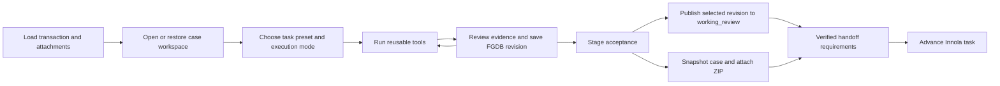

# Transaction Case Toolbox: Process And Task Matrix

## Direction And Confirmed Boundaries

The user wants reusable tools supporting automated, assisted, and manual examination. The transaction FGDB in ParcelWorkflowCases is the central spatial workspace. Case geometry and extracted tabular evidence travel together in a ZIP attached to Innola. Enterprise working_review is a published projection for persistence and shared visibility at selected checkpoints.

This is a process redesign with supporting architectural refactoring. Existing tools should be reused and separated from transaction-specific orchestration before new tools are developed.

Confirmed during this discussion:

- RC Examination refers to the existing RT Examination workflow.
- Compare is read-only for case geometry. Geometry corrections return to Compute, followed by revalidation and fresh comparison.
- The transaction type and attached sources remain context; they should not force every tool into a separate implementation.
- Compute must support single-parcel plans and multi-parcel Cad Maps, including geometry captured from plan dimensions or documented coordinates. Multiple parcels are first-class scope, not a later optional extension.
- The examiner chooses the working task/preset. Actual Innola task identity and permitted transition are validated before handoff; selecting a preset does not change Innola state.
- Initial multi-parcel handoff requires every included parcel to be accepted. Partial delivery is outside the initial scope.

This proposal does not change runtime behavior, sprint statuses, or existing locked architecture decisions. It proposes changes for subsequent alignment. The earlier toolbox draft remains intact.

## Refined Operating Model

Use one case workspace per current transaction, identified by normalized TR number. Existing linked PE transactions retain their own identities and workspaces.



Publish and package are independent checkpoint operations, not automatic side effects of every edit. Their required order and applicability belong to the task policy. Saving locally, suspending, publishing, attaching, and advancing must remain distinct commands/results.

Geometry states should distinguish draft, reviewed, accepted, stale, and superseded. Creating the FGDB at intake does not mean geometry has already passed examination. Draft geometry may be stored in explicitly separate draft datasets; accepted geometry is created or promoted only after the required review and checks.

## Six Toolbox Groups

| Group | Shared purpose | Main tools |
|---|---|---|
| Case & Sources | Open the correct workspace and preserve evidence | Load/restore, inspect attachments, select pages, crop evidence, load related case |
| Extract | Capture draft geometry evidence and key tabular values | Embedded-text extraction, OCR/vision, point-file import, metadata/party extraction |
| Check | Evaluate current evidence and geometry | File structure, dimensions, closure, orientation, georeference, parish consistency |
| Review & Edit | Resolve evidence and create accepted local geometry | Point/segment review, deterministic solve, manual map editing, approve revision |
| Compare & Evidence | Evaluate against source and external context | Source overlay, cadaster/overlap search, owners/title lookup, neighbor reconciliation |
| Save & Handoff | Persist and deliver a reviewed revision | Save, suspend, publish working copy, create report, attach ZIP, advance task |

A tool has one capability implementation. Presets supply recommended order, input defaults, required outputs, and permissions. Profiles can declare source requirements and tolerances without creating separate versions of shared tools.

Show a recommended task view and an all-tools view. Inapplicable or unavailable tools explain the reason. Tool execution prerequisites protect data integrity; stage acceptance gates determine whether the transaction can advance. These are separate concerns.

## Shared Task Matrix

Legend: Core = part of the normal task; Optional = available when relevant; Read = inspect reference geometry; No = no write authority in this task. These are proposed assignments, not assertions that every cell is implemented today.

| Individual task | Compute | Compare | Plan Annex A | Plan Annex B | RT Examination | Persisted result |
|---|---|---|---|---|---|---|
| Load/restore current transaction case | Core | Core | Core | Core | Core | Case identity and restored revision |
| Inventory/view source documents | Core | Core | Core | Core | Core | Source table and file references |
| Load linked PE/reference geometry | Optional | Optional | Optional | Core | Core, Read | Reference rows with originating TR/revision |
| Check file/document structure | Core | Core when stale/missing | Core | Optional | Optional | Findings linked to source hash |
| Select plan page/crop evidence | Optional | Optional evidence only | Core | Core/shared crop tool | Optional evidence only | Selected page/area and saved image/PDF |
| Extract points/segments from text or image | Core or manual alternative | No; return to Compute | Core or manual alternative | No new geometry extraction | No geometry extraction | Draft point/segment candidates and source trace |
| Import coordinate/geometry data | Optional | Read accepted/reference input | Optional | Read linked PE input | Read linked PE input | Provenance and normalized local data |
| Extract key metadata, owners, neighbors | Core/Optional by required fields | Optional, reviewed evidence | Core/Optional | Optional | Core/Optional | Structured candidates and reviewed values |
| Review/edit points, segments, anchors | Core | No; return to Compute | Core | No linked-PE edit | No linked-PE edit | Reviewed rows and correction history |
| Solve/build parcel geometry | Core | No; return to Compute | Core; local origin if permitted | No rebuild of linked PE | No rebuild of linked PE | Draft/accepted FGDB datasets |
| Manually edit/digitize case geometry | Optional | No; return to Compute | Optional within approved scope | No linked-PE edit | No linked-PE edit | Saved geometry revision and edit provenance |
| Check dimensions/closure/orientation | Core | Core verification if required | Core if dimensions available | Read/Optional | Read/Optional | Geometry findings with revision |
| Check georeference/parish/location | Core | Core when required | Optional or explicitly unreferenced | Read/Optional | Read/Optional | Placement status and findings |
| Overlay source/title image | Optional | Core/Optional by evidence | Core visual similarity | Core plan evidence | Optional | Placement/visual comparison evidence |
| Query cadasters, overlaps, ownership | Optional | Core | Optional | Optional | Core/Optional for neighbors | Query results, identities, spatial findings |
| Review parties/neighbors and task decision | Core/Optional | Core compare decision | Core annex decision | Core annex decision | Core RT neighbor/result decision | Reviewed tabular data and decision |
| Publish accepted FGDB revision | Configured checkpoint | Read latest accepted projection | Only if policy requires | No linked-PE overwrite | No linked-PE overwrite | Publish receipt and Enterprise revision |
| Report, snapshot, ZIP and attachment | Core at handoff | Core at handoff | Core plus generated annex evidence | Core plus crop/diagram evidence | Core plus RT evidence | Package manifest, report, upload receipt |
| Advance Innola workflow task | Explicit acceptance gate | Explicit compare gate | Explicit annex gate | Explicit annex gate | Explicit selected RT branch | Lifecycle receipt |

Checking the geometry in Compare is allowed. Editing/rebuilding it is not. Compare may save its own findings, metadata candidates, and decisions without changing accepted geometry. Replacing shared reviewed values must invalidate the dependent report/decision; extraction must not silently overwrite accepted values.

Returning to Compute means a controlled correction workspace and request. It does not imply permission to move the Innola task backward. The routing/ownership rule for that return remains a domain decision.

## Individual Tool Actions And Existing Foundations

These are separable actions discovered in current code/docs. Their presence is evidence for reuse, not a fresh runtime certification or proof of a unified toolbox API.

| Action family | Individual actions to expose | Existing foundation | Refactoring needed |
|---|---|---|---|
| Case lifecycle | Open, restore, save, suspend, snapshot | CaseFolderLayout, CaseResumePackageService, transaction lifecycle coordinator | Consistent workspace/revision contract and package policies |
| Source review | Inventory, view, page select, crop, save crop, attach evidence | Supporting Documents viewer; PlaPlanEvidenceSelectionService; PlaBSupportingDocumentCropService | Shared source selection context; retain explicit attach action |
| Geometry extraction | Probe text, extract text, extract scanned plan, parse coordinates | CreateParcelDraftExtractionAdapter; pdf_text_structured_extraction.py; survey_plan_ocr_vision_extraction.py | Separate route selection/execution from transaction-specific UI |
| Metadata extraction | Capture general facts, equipment, north arrow, owners/neighbors; review/accept fields | ExtractionReviewDocument and metadata view models; current extraction routes | Define minimum field catalog, missing-value semantics and standalone capability |
| Review/solve | Add/edit/exclude point or segment, identify anchor, solve, approve | ParcelScopedManualPointService; ManualBoundarySegmentService; SurveyPlanBoundarySolver; review persistence | Shared contract and provenance for manual FGDB edits |
| Check | Structure, dimension, georeference, validation, parish/closure/orientation | Persisted stage summaries; validation_adapter.py; configured rule catalogs | Run against selected saved revision; consistent stale-result handling |
| Local spatial output | Build datasets, load map, manual map work, save | OutputAdapterExecutionService; output_adapter.py; output/map integration services | Reuse stable transaction FGDB instead of losing edits on regeneration |
| Compare | Load geometry, query cadaster, compare evidence, overlap, look up owners/titles, decide, report | CompareWorkingGeometryService; CompareEvidenceComparisonService; CompareCadasterQueryServices; CompareReviewReportService; spatial overlap services | Prefer accepted local revision; keep Enterprise recovery explicit; retain read-only geometry |
| Plan Annex A | Select plan evidence, extract/review, local-origin solve, visual match, generate/attach documents | Workflow/Pla services and shared review solver | Preset over reusable tools; preserve unreferenced geometry label |
| Plan Annex B | Resolve linked PE, recover geometry/output GDB, crop diagram, attach, complete | PlaBWorkflowServices; shared crop service | Copy/reference provenance; current TR output identity separate from source PE |
| RT Examination | Load parent documents/linked PE, review neighbors, Save, select branch, Save & Close | InnolaRtExaminationService; RtExaminationModels | Shared read-only source geometry and current-RT evidence persistence |
| Enterprise projection | Publish, inspect receipt, recover reference data | JsonEnterpriseWorkingLayerPublishService; working-state restore services | Publish exact saved FGDB revision, stable keys, conflict and retry policy |

## Workspace And Data Ownership

Proposed conceptual layout; implementation must preserve existing package/path compatibility or migrate it explicitly:

```text
ParcelWorkflowCases/<TRnumber>/
  manifest.json
  source/                         original documents and downloaded evidence
  working/<TRnumber>.gdb/          current spatial workspace and evidence tables
  working/                        extraction runs, approvals, traces, compatibility JSON
  output/reports/                 generated reports and annex documents
  output/                         derived exports
```

The FGDB is authoritative for the current saved geometry and, in the target design, the reviewed structured tabular data. Original source documents and raw extraction records remain immutable evidence outside it. Package manifest, source documents, PDFs/images, and operational traces need not be forced into geodatabase tables.

During migration, current extraction/approval JSON remains the existing handoff contract. Do not declare FGDB tables authoritative while JSON is still independently editable. Introduce one write path and explicit projections before switching ownership. Future JSON/CSV exports carry the FGDB revision and are generated for compatibility/interchange, not maintained as a second editable truth.

Proposed FGDB datasets/tables:

| Dataset/table | Main content |
|---|---|
| DraftPoints, DraftLines, DraftParcels | Explicitly provisional geometry, separate from accepted datasets |
| Points, BoundaryLines, Parcels | Current accepted/reviewed geometry with stable parcel and feature IDs |
| CaseInfo, ParcelInfo | Current TR, linked/source TR, schema/revision, labels, area, coordinate reference and status |
| Sources, EvidenceValues | Source hash/page/area, raw value, reviewed value, units, confidence, review status |
| Parties, PartyRoles, Neighbors | Persons/entities, owner/occupier/representative roles, parcel links and adjacency |
| SurveyEquipment, PlanMetadata | Instrument/equipment, dates, parish, scale, north-arrow evidence and other selected fields |
| Findings, Decisions | Rule outcomes, examiner dispositions and approval tied to the relevant data revision |
| ToolRuns, RevisionHistory, PublishReceipts | Tool/version/operator/time, input/output references and sync status |

Stable identifiers include current TR, originating TR where relevant, parcel ID, document ID, evidence/feature ID and case revision. Do not use FGDB ObjectID as the cross-package/Enterprise identity. Document-wide metadata must survive even when only one parcel is selected.

Store missing, not applicable, uncertain and explicitly negative values distinctly. Separate observed north-arrow presence/direction from an approved geometric orientation correction. Owners, occupiers and neighbors are different roles and cannot be merged into one unlabeled field.

## Automated, Assisted And Manual Modes

All three modes write the same reviewed evidence model and case workspace.

| Mode | Behavior | Examiner boundary |
|---|---|---|
| Automated preparation | Run eligible checks, extraction and candidate construction in a declared sequence | Stop at unresolved evidence or required approval; no implicit publish/writeback/completion |
| Assisted | Suggest routes/tools, show candidates and findings, allow reruns and selective acceptance | Examiner chooses and approves corrections/results |
| Manual | Enter values, import geometry, digitize/edit in Compute, document evidence | Same required checks and acceptance gates; automation is not mandatory |

Automatic execution of non-destructive tools does not authorize automatic Innola advancement or authoritative cadastral writes. Any future unattended completion policy needs explicit separate requirements.

## Rerun And Correction Rules

1. Save edits before running a dependent tool; each run reads an identified saved input revision.
2. Rerun extraction into new candidates. Preserve accepted values/manual corrections until the examiner chooses replacements.
3. Record which fields or datasets changed. Invalidate only dependent checks, approvals, reports, published projections and packages.
4. Geometry changes invalidate dimension/georeference checks as applicable, geometry approval, comparison decisions and downstream outputs. Metadata changes invalidate the checks/reports that use those fields.
5. Retain prior accepted revision and comparison evidence as history. A failed run must not replace usable accepted data.
6. Compare can rerun checks against the same accepted revision. A correction request returns to Compute; after correction, Compare opens the new accepted revision and requires a fresh decision.
7. Saving/reopening must reconstruct tool readiness, stale findings and current revision from persisted data.

## Enterprise Projection And Handoff

Treat working_review as a transaction-scoped, versioned copy of the saved FGDB geometry. It is not a second unrestricted editing master and is not final Legal/Fiscal cadastre promotion.

Recommended initial checkpoint: publish on accepted Compute handoff, and republish after an accepted Compute correction. Other visibility checkpoints can be configured later. Draft visibility, if requested, must use a clearly labeled draft projection and cannot overwrite the accepted projection.

Publish payloads need current TR, originating TR where relevant, parcel/feature IDs, revision, source workspace, operator, timestamp and acceptance status. Repeated publish of the same revision must not duplicate features. Reject stale conflicting writes; detect partial points/lines/polygons publication before advertising a complete revision. Choose upsert/transaction-scoped replacement after reviewing Enterprise service capabilities.

Recovery order proposal: matching local case revision, verified latest Innola case package, then explicit Enterprise recovery. Do not silently substitute an Enterprise geometry-only copy for a complete resumable case. Detect newer remote revisions before opening an old local workspace as current. Linked PE geometry stays read-only in PLA_B and RT; current-task evidence is saved under the current TR.

Handoff actions:

1. Save and validate the required current revision.
2. Freeze a consistent snapshot of FGDB, reviewed tables, manifest, approval/findings, and required source/evidence files.
3. Generate reports and interoperable tabular exports from that revision.
4. Publish the same revision if this checkpoint requires Enterprise visibility.
5. Attach the ZIP and any separately required annex/report documents to the current TR; record confirmed receipts.
6. Advance only when all required uploads/publishes/writebacks have succeeded; query task state after an ambiguous transition failure before retrying.

Snapshot rather than ZIP a changing live geodatabase. Esri recommends ArcGIS operations for copying geodatabases and warns that filesystem copying during access can produce an invalid copy. The proposed implementation is to save/quiesce writes, use a supported ArcGIS copy into a staging snapshot, validate it, then ZIP the snapshot. Skipping .lock files alone does not establish snapshot consistency. See [Esri file geodatabase handling](https://doc.esri.com/en/arcgis-pro/latest/help/data/geodatabases/manage-file-gdb/file-geodatabases-and-windows-explorer.html) and [Copy a geodatabase](https://doc.esri.com/en/arcgis-pro/latest/help/data/geodatabases/overview/copying-a-geodatabase-using-the-copy-tool.html).

Packaging and Enterprise publishing are not one distributed transaction. Persist separate receipts so a retry resumes the failed operation without repeating completed uploads or task transitions. Distinguish saved locally, published, attached and advanced statuses.

## Refined Single-Parcel Example

1. Load the PE transaction and determine the current Innola task is Compare.
2. Restore/open its case package and accepted FGDB revision; inventory the survey plan and existing tabular data. A one-parcel source does not require a separate geometry engine.
3. Present the Compare preset: source/structure verification, geometry/dimension/georeference verification, visual overlay, external cadaster evidence, key metadata review, compare decision and report.
4. Skip already-current checks when their inputs and rule versions are unchanged; permit explicit reruns.
5. If accepted geometry is missing or needs correction, record the issue and return it to the Compute correction workspace under an approved routing/ownership rule.
6. In Compute, select embedded-text, scanned extraction or manual entry; capture points/segments and key values separately; review/solve or manually correct geometry in the FGDB.
7. Validate and accept the revised geometry; persist tabular evidence and provenance; publish the revised accepted snapshot if required.
8. Reopen Compare against that revision, repeat affected checks and make a new compare decision.
9. Snapshot the complete case, including FGDB and reusable tabular data, attach it and the required report, then advance the Innola task once its gate passes.

## Winston's Architecture Perspective

The useful abstraction is a shared case workspace plus small tool contracts, not a new engine per transaction type. Each contract identifies tool/version, input revision, scope, permissions, prerequisites, outputs, invalidation effects, cancellation/retry behavior and outcome. Reuse existing services behind those contracts rather than rewrite their domain logic.

Three layers should stay separate: tools perform capabilities; task presets organize them; lifecycle services enforce publish/upload/transition side effects. A type/profile chooses defaults. A stage limits write authority and defines acceptance. Source roles and data state determine whether a capability can run.

Important implementation findings:

- CaseFolderLayout already organizes source/working/output beneath the transaction case folder.
- CaseResumePackageService includes source and working files, but includes full output artifacts only when requested. FGDB inclusion must be verified for every save/suspend/handoff policy after its path is settled.
- CompareWorkingGeometryService currently loads Enterprise points/lines/polygons. The proposed local-first accepted FGDB reader is a change, not existing behavior.
- JsonEnterpriseWorkingLayerPublishService reads output feature records and has approved-review-row fallback paths. A central FGDB requires a single revision-consistent export path that cannot silently reconstruct stale geometry after manual edits.
- The current baseline keeps extraction_review_data.json and approved_review.json as canonical handoffs. Replacing their editable ownership with FGDB tables is a deliberate contract migration, not just button rearrangement.
- RT Save/Save & Close has current-Plan neighbor/checklist/branch semantics. Shared packaging/toolbox controls must preserve those differences and must not write SpatialUnit changes.

This perspective is an architecture review within this proposal, not a separately executed implementation or independent validation.

## Simplification And Delivery Proposal

Replace duplicated end-to-end flows with reusable capabilities and five task presets: Compute, Compare, PLA_A, PLA_B and RT. Simplify the UI to the six groups while keeping structure, dimensions and georeference as distinct checks/results inside Check. Combine save/package/report mechanics but retain task-specific decisions and writeback permissions.

Recommended first proofs: both a single-parcel plan and a multi-parcel Cad Map run Compute, save reviewed geometry and tabular evidence in a versioned workspace, package/restore it, open read-only Compare, request a correction, and compare the new revision. The multi-parcel proof must include a blocked parcel and a shared-boundary correction. Reuse current tools; do not begin with a full UI rewrite.

Then migrate shared source selection/crop, metadata and handoff services into PLA/RT presets. Map old sprint backlog acceptance criteria to these capabilities before creating replacement development stories.

## Multi-Parcel Cad Maps

One transaction owns one case workspace/FGDB containing one or many parcels. A separate FGDB per parcel is not the default design. A coordinate document may define several parcel groups; a plan may span multiple pages. Do not equate document, page or transaction with exactly one parcel.

- Each parcel has a stable parcel ID, label/lot number, point/segment membership, geometry state, revision and findings.
- Source documents, survey facts, equipment and document-wide parties remain case/document data unless explicitly linked to a parcel.
- Owners, neighbors and decisions can link to one or more parcels. Preserve those links instead of copying every party into every parcel.
- Review controls may select one parcel or a set. Case summaries show discovered, included, unresolved, accepted and excluded parcel counts separately.
- Excluding an extracted candidate requires a reason; it cannot silently disappear from the case history.
- A shared boundary has explicit adjacency evidence. Editing it invalidates checks for every affected parcel, not only the currently selected parcel. The exact shared-edge representation needs architectural design.
- Extraction reruns preserve accepted parcel identities and manual corrections. Proposed group splits/merges require explicit reconciliation and lineage.
- Package/restore and Enterprise publishing preserve all included parcel identities and the case revision; no fallback may flatten the case to the first parcel.
- Parcel approval is recorded per parcel; case acceptance requires all included parcels accepted, as confirmed by the user. Partial delivery is outside the initial scope. Legitimate exclusion requires documented scope and examiner disposition; it must not be used to conceal a failed included parcel.

Story 11.2 already defines first-class parcel groups and compatible single/multi-parcel loading. Reuse that planning foundation, but do not silently expand its current contract-only scope into FGDB migration, tool routing or UI replacement.

## Identifying Tasks, Steps And State

The word stage currently mixes several concepts. Give each concept its own identity before changing the screens:

| Concept | Example | Identification | What it controls |
|---|---|---|---|
| Transaction type/profile | PE, Cad Map source profile, PLA | Innola type plus configured normalized profile | Source expectations and suggested defaults |
| Official workflow task | Compute, Compare, Plan Annexation, RT Examination | Innola workflow/task definition identifiers where exposed, plus active task instance ID | Ownership, write permissions and allowed handoff |
| Selected working task/preset | Compute selected while Innola remains at Compare | Examiner selection with a stable application preset ID | Local tool organization and selected workspace behavior; no implicit server transition |
| Internal examination step | Structure Check, Dimension Check, Review Geometry | Stable application step ID such as structure_check or dimension_check | Recommended sequence and completion evidence |
| Tool capability | Extract embedded text, solve boundary, crop evidence | Stable tool ID and tool version | Inputs, outputs and execution prerequisites |
| Evidence/geometry state | Draft, accepted, stale, blocked | Persisted state tied to parcel/case/input revision | Whether results can be reused or must be rerun |

The examiner can be in the official Compare task, choose a Dimension Check tool, and inspect an accepted parcel revision. Running that check does not move the official task to Compute. A stale finding also does not itself change the Innola task.

Proposed task resolution:

1. Read the current Innola transaction, available/selected active task instance, workflow definition and stage metadata.
2. Use a versioned configuration mapping to normalized task presets. Prefer stable server identifiers when available; verify the actual API fields before designing the final contract.
3. Support known display-name aliases only as explicit compatibility mappings. Do not infer a task from document shape, parcel count or loose substring matching.
4. If several Innola tasks are active, select the target task explicitly with operator permissions before server writes. If server identity is unknown/ambiguous, show it separately from the selected working preset. Local preparation may continue within workspace permissions; server writes and handoff remain unavailable until resolved.
5. Refresh and revalidate task identity/ownership before lifecycle writes so an old toolbox view cannot advance a changed task.

Proposed mapping record: mapping version, Innola workflow/task-definition identifiers, known stage aliases, normalized task preset, allowed capabilities/write scopes, source requirements, acceptance policy and permitted transition targets. The active task instance ID is runtime context, not a permanent configuration key.

Confirmed business split: the examiner selects the working preset and tools. Innola supplies the actual official task against which handoff is validated. A manually selected workspace must not claim a different official Innola stage without a supported workflow operation.

Show both values explicitly, for example Selected Workspace: Compute and Innola Task: Compare. Selecting Compare always opens geometry read-only; selecting Compute permits authorized local correction work without claiming an Innola return transition. Changing presets records the reason and preserves case history. Existing user/session/geometry write permissions still apply.

Before publish/upload/transition, validate current server task/ownership, target handoff compatibility, required evidence for the selected preset and actual target task, accepted case revision, and acceptance of all included parcels. Validate each earlier server-side action as well; do not defer upload or writeback authorization until the final transition. A mismatch requires choosing a compatible handoff or a supported explicit workflow return/reassignment, rather than silently advancing a different stage.

## Parallel Design And Development

Current branch inspected on 2026-10-08: wipRC9. Keep current development usable while this proposal is refined.

Design sequence:

1. Inventory existing tools with their actual inputs/outputs, reusable services and task-specific side effects.
2. Walk representative scenarios: single parcel, multi-parcel Cad Map, manual entry, Compare correction, PLA_A, PLA_B and RT. Document ordinary and failure/reopen paths.
3. Build the task-definition mapping from actual Innola workflow evidence; record unresolved names, branches and permissions as decisions.
4. Agree workspace data ownership, parcel/adjacency model, rerun invalidation and package/publish checkpoints.
5. Review a static or isolated prototype of task selection, parcel selection and tool availability before changing operational screens.
6. Produce an architecture decision record and a migration/story plan with Mary/Winston perspectives. Reconcile overlap with Epic 11 and legacy backlog.
7. Implement the first isolated vertical slices only after the core decisions are stable; verify both single- and multi-parcel cases before adoption.

Implementation isolation proposal:

- Create a sibling Git worktree on a dedicated toolbox branch from an identified baseline commit; retain wipRC9 for current work. Capture current operational changes explicitly before choosing that baseline. Untracked design artifacts require deliberate inclusion because a worktree will not inherit them automatically.
- Use a separate configured case root and copies of test documents/packages. Do not migrate or overwrite the operational ParcelWorkflowCases during experimentation.
- Use separate test Enterprise targets or a verified isolated transaction/revision scope; start with mock/dry-run publishing and Innola writes.
- Preserve current package formats/loaders with adapters and explicit migration versions. Keep the operational reader usable until the new reader proves compatibility.
- Build the experimental add-in without replacing the operational registration. Separate installation identity/test profile or an isolated test environment must be designed before side-by-side installation; a Git branch does not isolate installed add-ins.
- Keep baseline and toolbox builds reproducible. Port selected shared fixes deliberately, and merge toolbox behavior only after fixture and operational acceptance.

No branch, worktree, deployment change or data migration was performed in this design review.

## Decisions Still Open

- Exact FGDB name/location and migration from existing output GDBs.
- Minimum mandatory metadata fields per task; equipment/north arrow may be useful evidence without always being handoff blockers.
- Who owns a Compute correction requested during Compare, and whether Innola requires a formal task reassignment/return transition.
- Which checkpoint publishes working_review, whether it is mandatory at handoff, and whether draft shared visibility is needed.
- Conflict handling when another operator has uploaded a newer case revision.
- Required source/evidence retention and package size policy, including links versus bundled files.
- Whether RT/PLA_B use a read-only copied reference FGDB or an explicitly linked reference within the current case; neither may overwrite the originating PE.

## Source References

- toolbox-transaction-stage-architecture.md (prior proposal, left unchanged)
- docs/project/COMPUTE_STAGE_STEPS_AND_RULES.md
- _bmad-output/planning-artifacts/plan-examination-general/plan-examination-pipeline-inventory.md
- _bmad-output/project-context.md
- src/ParcelWorkflowAddIn/ParcelWorkflowAddIn/CaseFolders/CaseFolderLayout.cs
- src/ParcelWorkflowAddIn/ParcelWorkflowAddIn/CaseFolders/CaseResumePackageService.cs
- src/ParcelWorkflowAddIn/ParcelWorkflowAddIn/Compare/CompareWorkingGeometryService.cs
- src/ParcelWorkflowAddIn/ParcelWorkflowAddIn/Workflow/Output/JsonEnterpriseWorkingLayerPublishService.cs
- src/ParcelWorkflowAddIn/ParcelWorkflowAddIn/Workflow/Pla/
- src/ParcelWorkflowAddIn/ParcelWorkflowAddIn/Workflow/RtExamination/InnolaRtExaminationService.cs

Review scope: source/doc inspection and process design. No code changes, runtime tests, live service calls or sprint transitions were performed.
