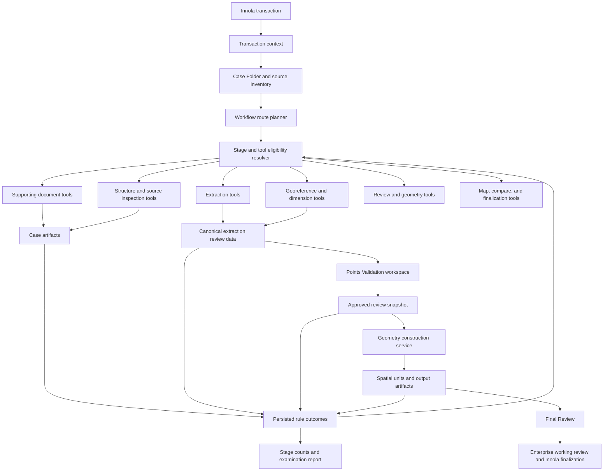

# Toolbox And Transaction Stage Architecture

## Decision Summary

Continue the project, but pause unrelated feature expansion while the next implementation tranche is organized around one value stream:

> Convert transaction source documents into reviewed, traceable, and reproducible parcel geometry for one or more parcels.

The existing architecture remains valid. This addendum narrows the next delivery focus and defines how a transaction-aware toolbox should connect source documents, extraction, review, geometry construction, stage rules, and completion evidence.

The toolbox is not a collection of independent buttons. A tool is available only when the current transaction profile, workflow stage, source evidence, artifact state, and workflow gates make it eligible.

## Why This Addendum Is Needed

The solution already has substantial working capability:

- Innola transaction loading and Case Folder creation.
- Source-role detection and workflow routing.
- Embedded-text PDF extraction.
- Scanned survey-plan OCR/vision extraction.
- Point and boundary-segment review.
- Deterministic boundary solving for surveyed traverses.
- Single-parcel and multi-parcel review behavior.
- Review approval, validation, geometry output, map review, Enterprise working review, and finalization paths.

The main risk is no longer absence of features. It is fragmentation: tools, stages, rule results, and artifacts can become difficult to understand if they are added without one explicit transaction-to-geometry operating model.

This addendum provides that model.

## Scope

This artifact defines:

- The document-to-geometry value stream.
- The transaction-aware toolbox model.
- Tool eligibility and invocation contracts.
- Stage inputs, outputs, counts, and gates.
- The canonical geometry evidence model for one or more parcels.
- Component ownership and architectural boundaries.
- A recommended implementation sequence and decision checkpoints.

This artifact does not:

- Replace the baseline architecture.
- Redesign the ArcGIS Pro add-in shell.
- Change current Innola finalization behavior.
- Treat OCR or AI output as authoritative.
- Promote working geometry directly into an authoritative cadastral store.
- Implement code or change runtime configuration.

## Target Operating Model



## Architectural Rule

Tool availability is calculated, not hardcoded in individual buttons:

```text
eligible tools =
  transaction profile
  intersect current stage
  intersect available source roles
  intersect artifact prerequisites
  intersect configured workflow rules
  intersect current gate state
```

Every unavailable tool must expose a concise reason, such as:

- Required source document is missing.
- Extraction has not completed.
- Three segment rows remain unresolved.
- Review approval is stale.
- Geometry cannot be created until the closure blocker is resolved.

## Transaction Context

All toolbox launches use one shared transaction context. The minimum context is:

| Field | Purpose |
|---|---|
| `transaction_number` | Stable Case Folder and audit identity. |
| `transaction_type` | Innola transaction type as received. |
| `transaction_profile` | Normalized workflow profile used by the add-in. |
| `current_stage_id` | Current Compute or examination stage. |
| `case_folder_path` | Root for auditable local artifacts. |
| `source_inventory` | Required and optional source-role status. |
| `active_parcel_group_id` | Current parcel context for parcel-scoped tools. |
| `review_version` | Current review data version/hash. |
| `operator_id` | User responsible for the action. |
| `run_id` | Correlates tool invocation, results, logs, and rule outcomes. |

The transaction context should be created by workflow services and passed to tools. Tools should not independently rediscover transaction identity, paths, or workflow state.

## Toolbox Model

The toolbox has six capability groups. The groups are stable; the tools shown inside them are resolved from the transaction context.

| Group | Purpose | Representative capabilities |
|---|---|---|
| Case and Sources | Establish the transaction evidence package. | Load transaction, refresh attachments, inspect source inventory, select plan evidence page. |
| Extract | Convert source evidence into draft structured data. | Embedded PDF text extraction, OCR/vision extraction, coordinate-file parsing, DWG inspection. |
| Review and Solve | Let the examiner establish the trusted parcel evidence. | Edit points, edit segments, classify anchors, rebuild points, solve boundary, approve review. |
| Build Geometry | Create spatial units from approved evidence. | Construct one or many parcel rings, calculate closure/area, create GDB/GeoJSON, add layers to map. |
| Map and Compare | Review geographic placement and external evidence. | M-Geo overlay, title-plan placement, cadaster comparison, working-review inspection. |
| Complete | Produce evidence and advance the transaction. | Final Review, report generation, Enterprise working publish, Innola attachment/writeback. |

### Toolbox Launch Contract

Each tool definition must declare:

| Contract area | Required definition |
|---|---|
| Identity | Tool id, display name, version, capability group. |
| Applicability | Transaction profiles and allowed stage ids. |
| Prerequisites | Source roles, artifacts, review state, and rule gates. |
| Scope | Transaction, document, parcel, segment, point, or map. |
| Inputs | Contract names and versions read by the tool. |
| Outputs | Artifacts and persisted rule outcomes written by the tool. |
| Metrics | Counts and statuses returned for the stage summary. |
| Blocking behavior | Conditions that block, require disposition, warn, or report only. |
| Recovery | Rerun, resume, overwrite, and stale-artifact behavior. |

Each invocation returns a structured result. A successful process exit without the expected artifact is still a failed tool result.

## Stage And Tool Matrix

| Stage | Primary tool action | Reads | Writes | Required examiner signal |
|---|---|---|---|---|
| Supporting Document Check | Inspect transaction sources | Innola attachments, manifest | `manifest.json`, source inventory outcomes | Required found, missing, unsupported counts |
| Structure Check | Verify files and route readiness | Manifest, workflow rules, source files | `structure_check_summary.json` | Blocker and warning counts |
| Data Extraction | Run eligible extraction routes | Source inventory, route plan | `extraction_review_data.json`, route-specific summaries | Parcels, points, segments, anchors, warnings, blockers |
| Georeference Check | Evaluate coordinate placement evidence | Review data, source metadata, optional coordinate sources | `georeference_check_summary.json` | Coordinate source, bounds, and reference conflicts |
| Dimension Check | Evaluate boundary construction evidence | Points, segments, bearings, distances, areas | `dimension_check_summary.json`, solver diagnostics | Parse, continuity, closure, and area results |
| Validate Points and Lines | Review, correct, solve, and approve | Canonical review data | Updated review data, `approved_review.json` | Unresolved count equals zero or is dispositioned |
| Create Spatial Units | Construct output geometry | Current approved review, validation results | Output GDB, GeoJSON, output summary | Created, failed, and skipped parcel counts |
| Final Review | Confirm spatial and report evidence | Stage summaries, map outputs, reports | Final review decision | Blockers resolved and outputs accepted |
| Finalize | Attach, publish, and transition | Approved outputs and final review | Lifecycle audit, Innola evidence, configured working publish | Completion or recoverable failure status |

## Transaction And Source Routes

### Unified Plan Examination

The target user-facing workflow is `PE / Plan Examination`. PXA remains a compatibility profile during migration and should not remain a separate long-term user concept.

Required sources:

- `st_surveyplan`
- `st_surveysheet`

Optional sources:

- `st_autocad_file`
- `st_survey_points`

Supported extraction behavior:

- Embedded-text documents use deterministic text extraction when suitable.
- Scanned/image documents use OCR/vision extraction when configured.
- Structured point sources use deterministic parsing.
- DWG supplies context, structural evidence, or validation support unless a rule explicitly selects it as geometry evidence.
- All routes normalize into the same canonical review contract.

The same workflow must support one or many parcel groups without separate UI routes.

### Plan Annexation A

The selected plan page or evidence area is the source for extraction and review. Geometry may be created in a documented local coordinate origin when the transaction rules permit unreferenced output. The artifact must state that the geometry is unreferenced.

### Plan Annexation B

The geometry source is the related Plan Examination output and Enterprise `working_review` evidence. It is a recovery/reference route, not a new OCR extraction route.

### RT Examination

Spatial units are read-only transaction context. RT tools must not mutate Plan Examination geometry or write SpatialUnit changes.

## Canonical Review And Geometry Evidence

`working/extraction_review_data.json` remains the canonical handoff between extraction and human review. Story 11-2 is the correct next implementation boundary.

The contract must represent:

- Transaction and workflow identity.
- Source inventory and extraction route evidence.
- Transaction-wide metadata, parties, memorandum, and findings.
- One or more stable parcel groups.
- Point rows assigned to parcel groups.
- Boundary segments assigned to parcel groups.
- Source trace for every material extracted or reviewed value.
- Raw values and reviewed overrides.
- Point provenance and anchor classification.
- Solver diagnostics and geometry readiness per parcel.
- Extraction quality counts and review status.
- Compatibility fields for current PE and PXA consumers.

Anchor classification should be represented on canonical point evidence rather than by copying coordinates into a second competing collection. A future read-only `anchors` projection may be added for UI convenience.

### Parcel Scope Rule

Transaction and document evidence stays global. Geometry evidence is parcel-scoped:

| Evidence | Scope |
|---|---|
| Source inventory | Transaction/document |
| Survey metadata and memorandum | Transaction/document |
| Parties and representatives | Transaction/document unless explicitly parcel-linked |
| Parcel group identity | Parcel |
| Points and anchors | Parcel |
| Boundary segments | Parcel |
| Geometry solution and diagnostics | Parcel |
| Approval | Review snapshot containing all included parcels |

The active parcel selector filters Points, Boundary Segments, Preview, and parcel diagnostics only. It must not hide document-wide evidence.

## Geometry Construction Recipes

The geometry service chooses a declared recipe per parcel. It does not infer authority from whichever field happens to be populated first.

| Recipe | Evidence | Construction policy |
|---|---|---|
| Coordinate ring | Reviewed point coordinates and order | Construct ring from reviewed parcel point sequence. |
| Reviewed traverse | Reviewed bearings and distances plus at least one anchor | Traverse segments deterministically from the confirmed anchor. |
| Hybrid anchored traverse | Reviewed segments plus multiple reference points | Construct from segments, evaluate anchor residuals, preserve conflicts as findings. |
| Local-origin traverse | Reviewed bearings and distances without georeference | Allowed only by transaction policy; mark output unreferenced. |
| Recovered geometry | Existing approved PE/Enterprise geometry | Load as reference or transaction input according to profile rules. |

For surveyed traverses, the current policy remains:

```text
location source     = confirmed printed/reference coordinates
shape source        = reviewed boundary segments
derived coordinates = deterministic boundary solver
validation evidence = closure + document area + anchor residuals + coordinate system
```

Confirmed anchor conflicts block geometry creation. Unconfirmed OCR coordinate conflicts may be superseded by a reviewed, closing, area-consistent segment chain, but the original evidence and warning must remain.

## Geometry State Model

Each parcel has an explicit geometry state:

```text
not_extracted
draft_evidence
review_required
ready_to_solve
solved_with_warnings
blocked
approved
geometry_created
final_review_accepted
```

State is derived from persisted artifacts and rule outcomes. It must not exist only in WPF memory.

For multi-parcel documents, parcel states are visible individually. Transaction progression uses a declared approval policy:

- Default recommendation: all included parcel groups must be approved before Create Spatial Units.
- A future partial-output policy must be explicit in workflow configuration and reports; it must never occur implicitly.

## Counts, Statuses, And Gates

Counts explain the evidence. Gates control progression. A count alone must not decide workflow state.

| Category | Minimum visible measures |
|---|---|
| Sources | Required, found, missing, unsupported |
| Extraction | Parcels, points, segments, anchors, metadata fields |
| Review | Unreviewed, accepted, corrected, excluded, unresolved |
| Solver | Solved parcels, closure failures, area failures, confirmed-anchor conflicts |
| Rules | Passed, failed, warning, not applicable, skipped, disabled |
| Geometry | Created, failed, skipped, unreferenced |
| Completion | Reports generated, attachments uploaded, publishes completed, lifecycle failures |

Every stage summary should expose:

- Status.
- Blocker count.
- Requires-disposition count.
- Warning count.
- Last run time.
- Artifact version/run id.
- Stale/current indicator.
- Next eligible action.

Workflow gates use `workflow_effect`:

- `blocker`
- `requires_disposition`
- `report_only`
- `info`

This preserves reportable findings without making every failed rule a workflow blocker.

## Component Responsibilities

| Component | Owns | Must not own |
|---|---|---|
| Transaction Context Resolver | Normalized transaction/profile/stage identity | Extraction or geometry logic |
| Workflow Route Planner | Eligible route and ordered tool plan | Running scripts or normalizing output |
| Tool Eligibility Resolver | Tool availability and disabled reasons | UI-specific button state scattered across ViewModels |
| Route Executor | Adapter invocation, progress, cancellation, structured result | Business approval decisions |
| Artifact Normalizer | Canonical review contract from route-specific output | Source authority decisions made without review |
| Case Folder Store | Artifact paths, versions, hashes, recovery | Hidden in-memory workflow truth |
| Points Validation Workspace | Human correction, parcel-scoped review, approval | Final geometry generation in code-behind |
| Geometry Construction Service | Deterministic parcel geometry from approved evidence | Reading raw PDFs as a shortcut |
| Rule Outcome Store | Persisted stage findings shared by UI and reports | Duplicate UI-only result calculations |
| ArcGIS Map Services | Safe map/layer/overlay operations | Workflow routing or contract parsing |
| Finalization Services | Configured publish, attachments, and workflow transition | Silent authoritative promotion |

## Recommended Delivery Sequence

1. Implement Story 11-2 exactly as scoped: canonical single/multi-parcel review contract, compatibility loading, persistence, and tests.
2. Define the route planner output contract for required/optional sources, selected extraction route per source, fallback order, and expected artifacts.
3. Split `CreateParcelDraftExtractionAdapter.cs` into route planning, route execution, and artifact normalization responsibilities while preserving current behavior.
4. Normalize embedded-text, scanned/vision, structured-point, and DWG-context results into the canonical contract.
5. Generalize parcel geometry readiness and solver diagnostics so coordinate-ring and reviewed-traverse recipes share one per-parcel status model.
6. Add the transaction-aware toolbox presentation after the tool registry and eligibility rules are stable.
7. Add fixture-driven acceptance coverage for single-parcel, multi-parcel, scanned, embedded-text, conflicting-anchor, missing-georeference, and incomplete-boundary cases.

The toolbox UI should not be the first implementation step. Its behavior depends on the contract, route plan, and eligibility model being stable enough to display truthful actions and counts.

## Decision Checkpoints

### Continue

Continue implementation when:

- Story 11-2 preserves current PE/PXA behavior in compatibility tests.
- Every route writes or normalizes to the canonical review contract.
- One and many parcel groups can be reviewed without losing document-wide evidence.
- Geometry creation reads only approved review data.
- Stage counts and blockers are reproducible from persisted artifacts.

### Pause And Correct Course

Pause the tranche when:

- A route requires downstream services to reread source PDFs after approval.
- A UI tool needs hidden state that cannot be recovered from the Case Folder.
- PE and PXA require incompatible canonical models rather than compatibility normalization.
- Geometry creation depends on unreviewed OCR values.
- A tool cannot declare its transaction, stage, input, output, and blocking contract.

### Stop Or Reconsider The Architecture

Reconsider the architecture only if live fixtures prove that a canonical review contract cannot preserve enough source evidence for both point-defined and traverse-defined parcels, or if ArcGIS Pro cannot reliably host the required review and geometry workflow. Current implementation evidence does not indicate either condition.

## Decisions To Lock

| Decision | Recommendation | Status |
|---|---|---|
| User-facing examination workflow | Use unified `PE / Plan Examination`; retain PXA only as a compatibility profile. | Locked by Story 11-1 |
| Geometry timing | Create geometry only after review approval and validation gates. | Locked |
| Canonical handoff | Use `working/extraction_review_data.json` and `working/approved_review.json`. | Locked |
| One/many parcel model | Use first-class parcel groups in one contract. | Ready to implement in Story 11-2 |
| Toolbox behavior | Resolve tools from transaction, stage, sources, artifacts, and gates. | Proposed for approval |
| Multi-parcel approval | Require all included parcels by default; configure any partial-output exception explicitly. | Proposed for approval |
| Unreferenced PE geometry | Block by default; allow local-origin geometry only for profiles such as PLA that explicitly permit it. | Proposed for approval |
| Rule result reuse | Persist once and reuse in stage UI and reports. | Locked by Compute stage design |

## Open Domain Decisions

These do not block Story 11-2, but they must be resolved before generalized geometry construction is considered complete:

1. When `st_surveyplan` and `st_surveysheet` disagree, which evidence is authoritative for point coordinates, segment calls, parcel labels, and area?
2. Which closure, area-difference, and anchor-residual tolerance profiles apply by transaction/profile?
3. Can an examiner approve and output only selected parcels from a multi-parcel document, or is approval always transaction-wide?
4. Which transaction profiles besides PLA may create explicitly unreferenced local-origin geometry?

## Acceptance Criteria For The Next Tranche

The architecture is successfully realized when an examiner can:

1. Load a supported transaction and see the required and optional source package.
2. See only tools eligible for the current transaction and stage, with reasons for disabled tools.
3. Run the correct extraction routes without choosing legacy PE/PXA implementation details.
4. Review document-wide evidence and switch between one or more parcel geometry groups.
5. Correct points, segments, anchors, and parcel membership while preserving original evidence.
6. See clear counts, blockers, warnings, closure, area, and georeference diagnostics.
7. Approve a versioned review snapshot.
8. Create reproducible geometry from that approved snapshot only.
9. Reopen the Case Folder and reconstruct the same stage, tool, count, and geometry state.
10. Complete Final Review and configured Innola/Enterprise actions with an auditable artifact chain.

## References

- `_bmad-output/planning-artifacts/architecture.md`
- `_bmad-output/planning-artifacts/plan-examination-general/plan-examination-pipeline-inventory.md`
- `_bmad-output/planning-artifacts/plan-examination-general/plan-examination-story-slicing-plan.md`
- `_bmad-output/implementation-artifacts/11-1-inventory-and-decision-lock-for-plan-examination-unification.md`
- `_bmad-output/implementation-artifacts/11-2-unified-pdf-extraction-contract-for-plan-examination.md`
- `docs/project/PROCESSING_ALIGNMENT.md`
- `docs/project/COMPUTE_STAGE_STEPS_AND_RULES.md`
- `docs/project/EXTRACTION_PROMPTS_AND_RULES.md`
- `src/ParcelWorkflowAddIn/ParcelWorkflowAddIn/Settings/WorkflowRules.json`
