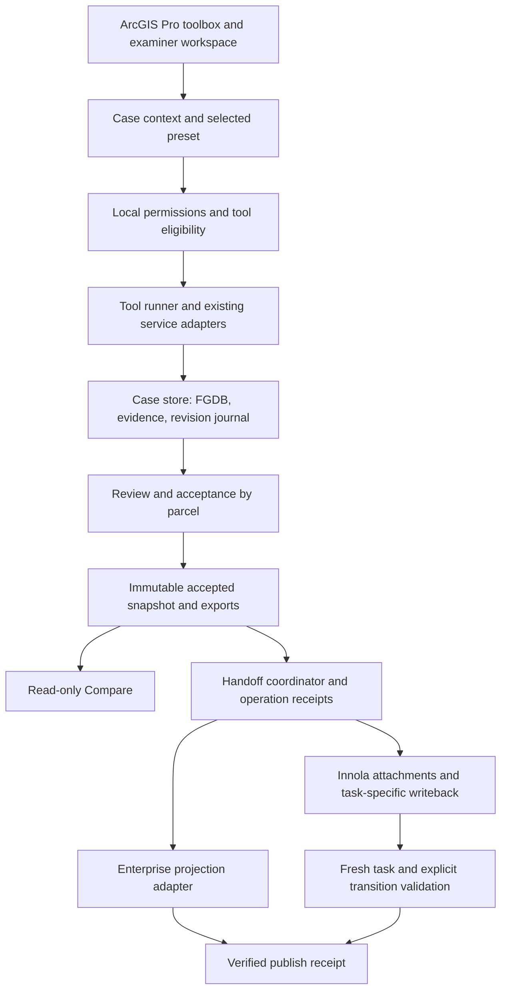

# Toolbox Architecture

Story: 13.2
Date: 2026-10-08
Status: architecture direction accepted by JotaPe on 2026-10-08; implementation feasibility gates remain
Owner: Winston - Architecture
Prerequisite: JotaPe accepted Story 13.1 on 2026-10-08.

## Architecture Position

Compute/Compare policy follow-up: [isolated settings mapping](toolbox-review-policy-settings-design.md) defines a proposed separate versioned review policy, distinct applicability/effects and case-pinned snapshots over the approved C15 matrix. Its JSON seed is a planning artifact with unresolved bindings and cannot activate. No legacy settings integration is implied.

Use a local transaction case workspace as the authoritative editing boundary. Compose existing services into tools and task presets. Keep examiner workspace selection separate from server workflow identity. Shared Enterprise geometry is a published revision, not another editable master.

This design preserves the accepted [process](toolbox-process-definition.md). It proposes technical choices, not deployment or implementation. Open policy/service-capability decisions remain in the [register](toolbox-decision-register.md); affected implementation is not ready until resolved.

## Components And Ownership

| Component | Owns | Existing boundary to reuse | New responsibility |
|---|---|---|---|
| Context/preset service | Current/source TR, selected preset, server task observation | SelectedInnolaTransaction, WorkflowWorkspacePlanner | Independent workspace selection; mapping provenance |
| Tool policy/runner | Prerequisites, permissions, scope, cancellation/result | Script executor/adapters and pure services | Tool descriptor catalog; no dynamic plugin loading |
| Case store | Reviewed tables, geometry, journal, revisions | CaseFolderLayout and review persistence | Single writer and recoverable commits |
| Domain adapters | Extraction, solving, rules, queries, rendering | Existing Python and C# domain services | Explicit revision inputs/outputs; no hidden discovery |
| Approval service | Included parcel set, current evidence and policy acceptance | Review hash and existing gate services | Per-parcel acceptance plus case aggregate |
| Snapshot/export service | Consistent immutable input for consumers | Output adapter and package mechanics | FGDB-based export, integrity and version provenance |
| Handoff coordinator | Task-specific ordered effects and receipts | Lifecycle, report/attachment/PLA/RT services | Retry-safe orchestration, fresh server authority |
| Projection adapter | Working geometry and selected-revision reader | Enterprise publish/restore and Compare readers | Exact FGDB revision; service-capability validation |

ArcGIS Pro remains the host, C#/WPF owns orchestration, and Python/ArcPy retains extraction/validation/geoprocessing. Preserve the current net8.0-windows/x64 lane observed in the project and desktopVersion=3.6 in DAML; no upgrade is part of this story. GIS/edit/GP operations remain behind SDK-safe adapters.

## Architecture Decisions

ADR recommendations below are accepted as the architecture direction following JotaPe's "architecture ok, so story 13.3" on 2026-10-08. This does not supply missing domain policy or prove service/deployment capabilities. Named readiness gates remain in force. Confirmed product choices are already accepted in 13.1.

| ADR | Alternatives and recommendation | Trade-off / readiness |
|---|---|---|
| A01 Case ownership | Active Toolbox FGDB at working/TR-<transaction-number>.gdb (user-confirmed naming); case registry maps current server identity to path. Reviewed spatial/tabular data owned by CaseStore after migration. Keep immutable raw evidence outside. | Central editing is simpler; needs explicit JSON/FGDB ownership cutover. D01 |
| A02 JSON compatibility | Retain current JSON-authoritative route during compatibility phase; target FGDB writer produces revision-stamped JSON projections for existing consumers. Never dual-write independently. | Adapter complexity avoids breaking extraction/approval/output. D01/D11 |
| A03 Revisions | Recommend monotonic case sequence plus globally unique revision ID, parent, actor and logical content fingerprint. One local writer; journal unfinished commits; immutable accepted snapshots. | Multi-file consistency/recovery needs a focused feasibility test; no filesystem transaction assumed. |
| A04 Parcels/shared edges | Stable parcel IDs and boundary IDs with membership/adjacency links; parcel rings are derived views of accepted boundary evidence. Keep independent source evidence, detect conflicts rather than force reconciliation. | Lightweight non-fabric model avoids premature Parcel Fabric dependency; manual edit propagation needs domain proof. D07 |
| A05 Task authority | Selected preset is local intent. Fresh server task instance, explicit transition target and authorization authorize server effects. Prefer verified definition mapping; configured aliases only as evidenced compatibility rules. | Unknown mappings block remote work, not local inspection/preparation. D02/D03 |
| A06 Tool registry | Statically registered typed descriptors/adapters, using existing service interfaces where possible. | No new plugin framework, embedded script engine or duplicate domain algorithms. |
| A07 Projection | Export frozen accepted FGDB revision; prefer supported same-service atomic edit request for geometry and case-index marker, under verified single-writer control. | Capability/lease/rollback semantics must be proven; existing independent delete/add is unsuitable as revision guarantee. D05/D06 |
| A08 Packaging | Save/quiesce, supported ArcGIS copy to staging, validate, checksum and ZIP whole snapshot. | Extra disk/copy time is worth consistent recovery. Packaging implementation is a later story. D10 |
| A09 Linked references | Recommend copied immutable accepted PE reference snapshot in current case with original TR/revision retained; local current-task tables writable, source geometry read-only. | Larger package avoids broken external paths; source access/retention policy pending. D08/D10 |
| A10 Isolation | Separate worktree, case root/config/targets and isolated test machine or environment; no side-by-side registration claim until verified. | A worktree alone does not isolate operational data/add-in registration. D09 |

### Confirmed Toolbox FGDB Naming

JotaPe confirmed on 2026-10-08 that new Toolbox FGDB names use `TR-<transaction-number>.gdb`: for transaction 999999999, `TR-999999999.gdb`. The legacy numeric-only FGDB naming stays unchanged. The digit count is illustrative, not a fixed-length requirement; preserve leading zeros and do not pad/truncate the transaction number.

This is a Toolbox filename convention, not a change to Innola TransactionId, original transaction-number values or legacy case-folder/package identity. Resolve the numeric transaction component through a validated mapper; do not duplicate an existing TR prefix or use a normalized filename as server authority. Missing/ambiguous/unsafe numbers or name collisions fail explicitly.

Future Story 13.5 persistence and 13.9 packaging must create/resolve the Toolbox-specific path explicitly. Do not silently rename existing FGDBs, search legacy numeric FGDBs as writable Toolbox masters, or change baseline output adapters. Separate roots, schema/revision checks and installation/service isolation remain required: a filename prefix alone does not isolate cases or resolve data authority.

The safe filename is derived by an existing validated naming service or new scoped mapper; preserve original TR/TransactionId as data. Reject path traversal and collision after normalization. Do not assume case IDs from different Innola environments are globally unique.

## Data Authority And Commit Protocol

Target ownership:
- FGDB: current saved draft/reviewed geometry, parcel relationships, reviewed facts, findings and approval records.
- Immutable files: original source copies, raw extraction candidates, generated evidence and accepted snapshots.
- Case manifest/journal: workspace paths, schema version, committed revision pointer and recovery status.
- JSON/GeoJSON/CSV: disposable revision-stamped projections for adapters/interchange; not independently editable masters.
- Operation ledger: remote operation IDs/receipts and reconciliation state, outside the frozen payload so upload progress does not alter its content.
- Enterprise: published revision only; no implicit geometry editing/import back to local authority.

Single writer serializes mutations by case. Local lease includes process/session owner and recovery state; it is not a distributed server lock. Operations that encounter a pending commit cannot approve, snapshot, publish or hand off.

Proposed commit:
1. Verify expected parent revision and permission; persist prepared journal with affected IDs/dependencies.
2. Perform a bounded SDK/ArcPy write operation and save FGDB edits. Record commit ID inside FGDB metadata with semantic input/output digest.
3. Compute/verify affected content and write revision record/projections to staging; mark fgdb_saved/catalog_written in journal.
4. Advance committed manifest pointer only after corresponding FGDB metadata and required catalog exist; mark committed.
5. On reopen, compare FGDB commit metadata, journal and manifest. Finish a verifiable pending commit or quarantine it and recover the previous accepted snapshot; never infer clean state from absence of an exception.

There is no claimed atomic transaction spanning FGDB plus filesystem. Interrupted writes remain detectable and must be recoverable in a spike before adoption. A failed mutation after partial persistence is quarantined, not falsely described as leaving the active data untouched.

Accepted snapshots preserve revision-bound geometry, tabular evidence, included parcel set, approval/rule versions and derived exports. Active editing may continue from the accepted revision; consumers needing approved evidence read the immutable snapshot, not mutable active classes. Manual map edits must be captured through the CaseStore commit path or trigger an untracked-edit blocker before approval/export.

Logical fingerprints use a documented canonical representation of selected fields, stable IDs, ordered evidence, geometry/CRS/units and rule/policy versions. Exclude ObjectID/index/lock bytes and nonsemantic display timestamps. Preserve ordered points and geometric semantics; define precision, curves/Z/M handling explicitly before implementation. Binary file checksums validate package transport, not logical approval equivalence.

## Parcel And Evidence Model

[Contract catalog](toolbox-contract-catalog.md) defines draft table outlines. Case/document facts remain global; point/segment memberships and diagnostics are parcel-scoped. Parties and evidence use link tables for many-parcel relationships.

BoundaryMembership links shared boundary IDs to parcel IDs with direction. Editing a shared edge affects every membership and invalidates their checks/approvals. If geometry and recorded adjacency disagree, report a conflict and block acceptance; do not silently snap/deduplicate boundaries. Independent rings can be imported, but shared-edge detection/disposition must establish relationships before asserting topology consistency.

Candidate reconciliation retains stable IDs where evidence supports identity. Split/merge requires explicit lineage and inclusion decisions; no automatic matching by array index/name alone. Approval binds included IDs, accepted geometry/evidence fingerprints and policy version. All included parcels must be accepted; an empty included set is not geometry-task success. Reference presets validate an explicitly selected accepted source parcel set without rewriting PE acceptance (D08).

## Actual Innola Evidence And Mapping

Observed source contracts, not a live API audit:
- SelectedInnolaTransaction contains TaskId, TransactionId, TransactionNumber, TaskName, ProcessStep, ApplicationId, TransactionType, Status, AssignedUser/Group.
- Transaction service calls GET /api/v4/rest/workflow/my-tasks and POST /api/v4/rest/application/my-tasks/search.
- Mapper accepts task_id/taskId/workflow_task_id/id and task_name/activity_name/name aliases. It can substitute transaction ID as task ID when the task field is missing. Such fallback is not sufficient evidence for a Toolbox mutation target.
- Lifecycle service uses workflow/tasks/{taskId}/start, GET .../transitions, and .../complete?transition={returned-transition}. It accepts transitionId/id/name and compares labels/target-stage aliases.
- Stable workflow/task-definition IDs are not present in SelectedInnolaTransaction. Their exact server fields/availability remain unknown, D02.

New context carries task resolution status and field provenance. IDs originating from fallback are marked unresolved until fresh evidence verifies the task instance. Display aliases organize tools; they are not authorization. Revalidate session with existing session manager, transaction identity, current task/assignment, compatible selected operation and returned transition immediately before every remote mutation.

In Toolbox mode require an explicit matching transition policy/selection. Do not fall back to the first/default transition merely because no desired name was configured. Existing baseline behavior remains unchanged until a dedicated adapter and tests are accepted. Request metadata is sanitized; no password/token is persisted.

The current publisher's transaction_id scope resolves the actual TransactionId, while Compare's helper can normalize the TR number for that field. Unify Toolbox identity mapping explicitly rather than blindly share either helper; validate configured field/value semantics against source metadata before queries.

## FGDB Exports And Consumer Changes

After target ownership cutover, all outputs and publishes are generated from a named accepted FGDB snapshot. Do not reconstruct geometry from approved rows or old GeoJSON merely because a feature class cannot be read. Missing/unreadable exact inputs fail explicitly.

Compute remains editable subject to local permissions. Solver rerun produces candidates and proposed deltas; replacing accepted/manual geometry requires review. Accepted source evidence and edited geometry can legitimately diverge but must have correction provenance and current checks.

Compare consumes accepted local/package revision; Enterprise is an explicit version-verified reference/recovery path. Compare cannot edit geometry. Changed geometry invalidates old comparison. PLA_A may allow clearly unreferenced local-origin output under its policy. PLA_B and RT retain source PE identity and prohibit PE writes.

RT retains explicit server Save versus Save & Close. Save preserves checklist and updates current Plan neighbor evidence; Save & Close applies the chosen current PlanCheck/transition and cleanup. Shared local Save must not masquerade as that server Save. Existing task-specific API arrays/templates and attachment types remain owned by their adapters.

## Enterprise Projection Protocol

Current FeatureService publisher performs deleteFeatures then addFeatures per layer; JSON targets replace scoped records independently. Neither inspected path proves multi-layer rollback or concurrency control.

Target adapter probes actual service/layer metadata: edit/query capabilities, stable fields/unique IDs, spatial reference, target layer roles, size limits, supported rollback/global-ID mechanisms and all participating layers sharing the required service boundary.

Preferred initial mode: verified exclusive publisher/owner, revision check, same-service applyEdits with supported rollback behavior, geometry changes plus current revision marker in one verified operation. Stable feature keys map to server identities; upsert removes superseded scoped features in that operation after reading the exact prior accepted revision. Check every returned feature result and then read back marker/counts/digest before recording published. Same successful operation/revision is a no-op on retry.

A query-before-write is not compare-and-swap. An enforceable exclusive publisher lease or server conflict mechanism is an entry requirement, not assumed available. Rollback alone does not prevent concurrent stale writes. If required layers span services or concurrency/atomicity cannot be established, block mandatory publish for initial release and record a separate spike. Do not advertise complete revision while layers disagree.

Alternative staged revision mode requires revision-qualified rows, reader filtering, a protected current-revision marker and cleanup. It is not an automatic fallback on operational layers because existing readers may ignore revision filters. Never write test revisions into current production targets.

Supported rollback/global-ID behavior depends on service metadata; consult official [service applyEdits](https://developers.arcgis.com/rest/services-reference/enterprise/apply-edits-feature-service/) and [layer applyEdits](https://developers.arcgis.com/rest/services-reference/enterprise/apply-edits-feature-service-layer/). This documentation does not prove the configured service supports the needed design.

Enterprise restore with geometry only is partial recovery, not an accepted complete case. Its revision/identity must be compared to local and package evidence; a newer remote case requires conflict handling, not automatic overwrite.

## Snapshot, Handoff And Cross-Task Restore

Save edits, pause writers/tool runs, create a supported ArcGIS geodatabase copy in staging, verify dataset/table coverage, parent/revision and integrity, then produce reports/projections and ZIP from that snapshot. Do not ZIP a live changing GDB or treat skipping .lock files as consistency. See [Esri geodatabase handling](https://doc.esri.com/en/arcgis-pro/latest/help/data/geodatabases/manage-file-gdb/file-geodatabases-and-windows-explorer.html) and [Copy](https://doc.esri.com/en/arcgis-pro/latest/help/data/geodatabases/overview/copying-a-geodatabase-using-the-copy-tool.html).

Package v2 separates case identity from creating task instance. A package created in Compute may be restored read-only/prepared for later Compare when current TR/server identity matches and its lineage/schema/contents validate. A different task ID is history, not proof of a different case and never transferred authorization. A different transaction/server identity still blocks restore. Legacy package v1 retains its original loader checks; cross-task compatibility is a new explicit adapter, not relaxed global validation.

Restore into staging, verify safe paths, package/schema version, bounded archive sizes, manifest checksums, revision chain and GDB readability. Compare newer local/remote revision evidence, retain old local case and switch only after verified replacement. Do not reuse existing destructive root replacement as the only recovery protection.

Handoff coordinator checks current task/authority and all required evidence, creates a persisted plan and executes task-specific actions with separate receipts. No distributed transaction among local files, Enterprise and Innola is claimed. Retry resumes or reconciles the failed step. Unknown upload/transition outcomes need read-back: local idempotency keys alone do not establish server idempotence. Existing confirmed receipts survive restart.

## Compatibility And Requirements Traceability

| Accepted process requirement | Component / contract | Acceptance scenarios | Baseline disposition |
|---|---|---|---|
| Examiner selection vs official task | Context, task mapping and mutation policy | S05/S12 | Adapt current route planner; new independent context |
| One/many parcels, shared edges | CaseStore, memberships/lineage and approval | S01-S03/S10 | Reuse 11.2 contract; explicit topology dependency |
| Same manual/automatic model | Runner, candidate batch and commit | S01/S04/S10 | Preserve current adapters/solver, adapt write ownership |
| Read-only Compare and linked PE | Accepted reader, source-reference contract | S05-S08 | Preserve write boundaries; local-first adapter proposed |
| Persistent geometry and key facts | Workspace schema, projections, revisions | S01/S02/S09 | Deliberate migration from JSON authority |
| Working copy and case package | Projection, package and ledger | S09/S11 | Replace unsafe assumptions; keep old paths for baseline |
| All included parcels accepted | Aggregate acceptance contract | S02/S03 | New shared gate over explicit included set |
| Parallel stable development | Isolation plan | Environment checks | Operational branch/data/registration preserved |

Historical architecture's Enterprise collaborative workspace and current JSON canonical handoff are adapted deliberately: target authority is local FGDB with checked projections, not unrestricted Enterprise editing. This new proposal does not silently rewrite baseline architecture or Epic 11 decisions. [Migration plan](toolbox-parallel-migration-plan.md) identifies the transition phases and [acceptance strategy](toolbox-acceptance-strategy.md) defines evidence gates.
